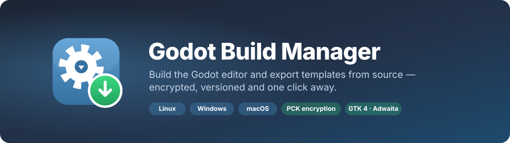
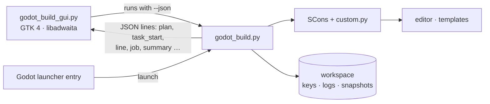

<p align="center">
  
</p>

<p align="center">
  <a href="LICENSE"></a>
  
  
  
  
</p>

<p align="center">
  <b>A native desktop app and CLI that turns a Godot source checkout into an optimized editor,<br>
  encrypted export templates for every platform, and a launcher entry that keeps itself up to date.</b>
</p>

---

Building Godot from source gives you engine fixes before they ship, smaller export templates and
**PCK encryption** — but it also means remembering SCons flags, cross toolchains, the template naming
scheme, the encryption key, the .NET glue step and which build you are actually running. Godot Build
Manager does all of that for you, with a GTK 4 interface that follows your desktop theme.

## Contents

- [Highlights](#highlights)
- [Requirements](#requirements)
- [Installation](#installation)
- [First run](#first-run)
- [Using the app](#using-the-app)
- [Command line](#command-line)
- [PCK encryption](#pck-encryption)
- [Cross-compiling for Windows and macOS](#cross-compiling-for-windows-and-macos)
- [Configuration](#configuration)
- [How it works](#how-it-works)
- [Troubleshooting](#troubleshooting)
- [Uninstalling](#uninstalling)
- [License](#license)

## Highlights

| | |
|---|---|
| 🛠️ **Editor builds** | Optimized editor for your machine (ThinLTO, CPU tuning, compiler cache), with C# glue and .NET assemblies generated for you. |
| 📦 **Export templates** | Linux, Windows (x86_64 / arm64) and macOS universal templates, release and debug, named and packaged exactly as the editor expects — installed directly or as a `.tpz`. |
| 🔐 **PCK encryption** | Generates the AES-256 key, compiles it into every template, verifies it is really there, and backs it up behind a passphrase. |
| ⏪ **Snapshots & rollback** | Every successful editor build is kept. Master broke something? Switch the launcher back to yesterday's build in one click. |
| 🔔 **Update notifications** | Opening Godot from your launcher quietly checks upstream and notifies you when there are new changes. |
| 📝 **Readable changelog** | Incoming changes appear as pull request titles grouped by engine area (Rendering, C#, Windows…), with the areas you care about highlighted. |
| 📈 **Build history** | Duration chart per build step, ccache hit rates, and a realistic *time left* while building. |
| 💾 **Storage** | See what caches, objects, snapshots and old templates cost on disk and clean them up safely. |
| 🩺 **Diagnostics** | Checks compilers, SCons, toolchains, SDKs, the key and the desktop integration, with one-click fixes — including installers for the Windows and macOS cross-compilers. |
| 🖥️ **Desktop integration** | Godot in your app launcher, `.godot` files open with your build, and right-click actions for the Build Manager and update checks. |

Everything the app does is also a plain command (`godot-build editor`, `godot-build templates --install`, …),
so it works the same over SSH, in scripts and in CI.

## Requirements

**Host:** Linux (x86_64 or arm64). The app builds the Linux editor natively and cross-compiles the
Windows and macOS templates.

| | Arch / Manjaro | Fedora | Debian / Ubuntu |
|---|---|---|---|
| App (GTK 4, libadwaita ≥ 1.7, PyGObject) | `python-gobject gtk4 libadwaita` | `python3-gobject gtk4 libadwaita` | `python3-gi gir1.2-gtk-4.0 gir1.2-adw-1` |
| Log viewer with line numbers *(optional)* | `gtksourceview5` | `gtksourceview5` | `gir1.2-gtksource-5` |
| Building Godot | `git scons clang` | `git scons clang` | `git scons clang` |
| Faster builds *(optional)* | `mold ccache` | `mold ccache` | `mold ccache` |
| C# / .NET builds *(optional)* | `dotnet-sdk` | `dotnet-sdk-8.0` | `dotnet-sdk-8.0` |
| Key backups *(optional)* | `gnupg` | `gnupg2` | `gnupg` |

GCC works too if you prefer it over Clang. libadwaita 1.7 ships with GNOME 48 (Fedora 42, Ubuntu 25.04, Debian 13
and newer). Python 3.10+ standard library only — there is nothing to `pip install`.

## Installation

```bash
git clone https://github.com/T1nkiePlayz/godot-build-manager.git
cd godot-build-manager
./install.sh
```

The installer checks the requirements, then adds **Godot Build Manager** to your app launcher and two commands
to `~/.local/bin`:

| Command | |
|---|---|
| `godot-build-manager` | the app |
| `godot-build` | the command-line tool |

It runs straight from the cloned folder, so `git pull` is all an update takes.

## First run

1. Open **Godot Build Manager**.
2. Choose your Godot source checkout — or let the app **clone Godot from GitHub** for you.
3. In **Settings**, click **Install the recommended custom.py** to get tuned production build options
   (you can keep your own `custom.py` instead).
4. Open **Diagnostics** to see what is missing, then **Build Editor**.

After the first build, use **Settings → Desktop Integration → Install** (or the banner) to put Godot in your launcher.

## Using the app

| Page | What it does |
|---|---|
| **Overview** | Version, status at a glance, quick actions and recent builds. |
| **Source** | Repository state, check for updates, the incoming changelog (filter by area or *watched only*) and one-click update + rebuild. |
| **Editor** | The installed build, .NET status, the launcher link, build options and **Versions** — every snapshot with *Use* and *Delete*. |
| **Export Templates** | Pick platforms, architectures and targets; encryption, .NET, install and `.tpz` options; staged and installed templates. |
| **Encryption** | Key fingerprint, reveal and copy (the clipboard clears itself), backup / verify / restore, and *Launch Godot with the key*. |
| **Activity** | Live build progress: every step with its own progress bar and time-left estimate, colour-coded output, a failure summary and cancel. |
| **Build Logs** | Every build log with search. |
| **Build History** | Duration chart per step, typical and fastest times, cache hit rate and recent runs. |
| **Diagnostics** | Toolchain, platform, dependency, machine, key and desktop checks with fix-ups. |
| **Storage** | Disk usage of everything the manager keeps, with cleanup. |
| **Settings** | Folders and toolchains, update checks and snapshot retention, `custom.py` toggles, desktop integration, maintenance. |

You can close the window during a build and let it finish in the background — you get a notification when it is done.

**Keyboard shortcuts:** <kbd>Ctrl</kbd>+<kbd>R</kbd> refresh · <kbd>Ctrl</kbd>+<kbd>L</kbd> launch Godot ·
<kbd>Ctrl</kbd>+<kbd>B</kbd> build editor · <kbd>Ctrl</kbd>+<kbd>Shift</kbd>+<kbd>B</kbd> build templates ·
<kbd>Ctrl</kbd>+<kbd>U</kbd> check for updates · <kbd>Alt</kbd>+<kbd>1</kbd>…<kbd>9</kbd> pages ·
<kbd>Ctrl</kbd>+<kbd>?</kbd> all shortcuts.

## Command line

```bash
godot-build setup --source-dir ~/src/godot   # or: godot-build clone ~/src/godot
godot-build doctor                           # what is installed, what is missing
godot-build toolchain install mingw          # Windows cross-compiler (+ `godot-build deps`)
godot-build toolchain install moltenvk       # Vulkan for macOS templates
godot-build toolchain install osxcross --sdk ~/Downloads/Xcode_26.xip
godot-build editor                           # optimized editor (+ C# glue when .NET is on)
godot-build key generate                     # create the PCK encryption key
godot-build templates --install              # every available platform, release + debug
godot-build templates -p windows -t release --arch windows:x86_64,windows:arm64
godot-build update                           # fetch, show the changelog, fast-forward
godot-build snapshot list                    # editor versions; `snapshot use ID` to roll back
godot-build integrate                        # launcher entry, icons, .godot file type
```

<details>
<summary><b>All commands</b></summary>

| Command | Description |
|---|---|
| `setup` | Set the source tree, workspace, llvm-mingw and osxcross folders. |
| `clone DIR` | Clone Godot from GitHub (`--branch`, `--shallow`) and use it. |
| `doctor` | Check toolchains and dependencies. |
| `toolchain` | `status`, `install mingw\|osxcross\|moltenvk\|all` (`--sdk FILE` for osxcross), `remove NAME`. |
| `editor` | Build the Linux editor (`--mono` / `--no-mono`, `--no-glue`, `-j N`, `-- extra scons args`). |
| `templates` | Build export templates (`-p`, `-t`, `--arch`, `--install`, `--tpz`, `--keep-going`, `--no-encrypt`, `--require-encryption`). |
| `all` | Doctor, editor, templates and install in one go. |
| `install` | Install staged templates (`--tpz` to also package). |
| `update` | Fetch and fast-forward the source tree (`--check` to only list changes). |
| `status` | Snapshot of editor, source, key and templates. |
| `key` | `generate`, `show`, `path`, `env`, `verify`, `backup FILE`, `check-backup FILE`, `restore FILE`. |
| `snapshot` | `list`, `create`, `use ID\|latest`, `delete ID`. |
| `history` | Build durations and cache statistics. |
| `storage` | Disk usage report; `storage clear ITEM`. |
| `config` | `list`, `set NAME VALUE`, `install-template [--force]`. |
| `deps` | Download the Windows build dependencies (ANGLE, D3D12 Agility SDK, Mesa NIR, AccessKit). |
| `integrate` | Desktop integration (`--remove` to undo). |
| `launch` | Start Godot, then run the background update check (used by the launcher entry). |
| `clean` | Remove staged output, logs or objects. |

Every command accepts `--json` and then prints one JSON object per line — the same event stream the app uses.

</details>

## PCK encryption

Godot can encrypt the scripts and resources inside exported `.pck` files, but only with export templates
compiled with your key. The manager handles the whole chain:

1. **Encryption → Generate Key** (or `godot-build key generate`) creates a random 256-bit key, stored with mode `0600`.
2. Build templates with **Encrypt PCK** on — the key is injected at build time and every binary is checked for it afterwards.
3. In your export preset, enable **Encrypt Exported PCK**, add include filters (`*.gd`, `*.tscn`, `*.tres` …) and paste
   the key — or start Godot with **Launch Godot with the key**, which provides it through `GODOT_SCRIPT_ENCRYPTION_KEY`.
4. **Back the key up.** Without it you can never build templates that open the PCKs of games you have already shipped.
   Backups are GnuPG-encrypted (AES-256) with a passphrase, verified after writing, and restorable from the app.

> [!NOTE]
> PCK encryption raises the bar against casual extraction; the key necessarily ships inside the game binary.
> Treat it as protection against tampering and copying, not as DRM.

## Cross-compiling for Windows and macOS

Open **Diagnostics → Cross-Compile Toolchains** (or use `godot-build toolchain`). Everything is installed into
`<workspace>/toolchains`, with live progress on the Activity page, and is picked up automatically.

| Toolchain | Used for | What the installer does |
|---|---|---|
| [llvm-mingw](https://github.com/mstorsjo/llvm-mingw) | Windows templates | Downloads the latest Linux release (~85 MB), then Godot's Windows dependencies (ANGLE, Direct3D 12, Mesa NIR, AccessKit). |
| [osxcross](https://github.com/tpoechtrager/osxcross) | macOS templates | Clones osxcross, extracts the macOS SDK from the Xcode `.xip` you choose and builds the toolchain (5–20 minutes). |
| [MoltenVK](https://github.com/KhronosGroup/MoltenVK) | Vulkan on macOS | Downloads the static `MoltenVK.xcframework` (~57 MB) and links it into macOS templates. |

**About the macOS SDK.** Apple only distributes it inside Xcode, so the manager cannot download it for you.
Sign in at [developer.apple.com/download](https://developer.apple.com/download/all/?q=xcode) with a free Apple
account, download an Xcode `.xip`, and choose it in the installer. A `MacOSX<version>.sdk.tar.xz` packaged on a Mac
with osxcross's `gen_sdk_package.sh` works too. Read the Xcode licence first: it only permits use on Apple hardware.
Building osxcross also needs `clang cmake git patch make xz cpio` plus the libxml2, OpenSSL, zlib and bzip2 development
headers. The installer lists anything missing with the command for your distribution.

macOS templates are combined into one universal (arm64 + x86_64) template with `lipo`. Apple Silicon uses Metal.
Without MoltenVK, Intel Macs fall back to OpenGL. **Settings → Vulkan on macOS** turns MoltenVK off again.

Platforms whose toolchain is missing are greyed out on the Export Templates page, with a **Set Up Toolchains…** button.

## Configuration

Settings are stored in `~/.config/godot-build-manager/config.json` and are all editable from the app:

| Setting | Default |
|---|---|
| `source_dir` | *(set on first run)* |
| `workspace_dir` | `~/.local/share/godot-build-manager` |
| `llvm_mingw` | auto-detected: `<workspace>/toolchains/llvm-mingw`, `/opt/llvm-mingw`, `~/llvm-mingw`, `PATH` |
| `osxcross_root` | auto-detected: `<workspace>/toolchains/osxcross`, `~/osxcross` |
| `moltenvk_sdk` | auto-detected: `<workspace>/toolchains/moltenvk` |
| `macos_vulkan` | `true` |
| `manager_in_launcher` | `true` |
| `auto_check`, `auto_check_hours` | `true`, `6` |
| `watch_paths` | `modules/mono, editor/export, platform/linuxbsd, platform/windows, core/crypto` |
| `snapshot_keep` | `5` |

Environment variables override the file: `GODOT_SOURCE`, `GBM_WORKSPACE`, `GBM_CONFIG_DIR`, `MINGW_PREFIX`, `OSXCROSS_ROOT`.

<details>
<summary><b>Workspace layout</b></summary>

```
~/.local/share/godot-build-manager/
├── keys/godot.gdkey        PCK encryption key (0600)
├── logs/                   build logs, history.jsonl, state
├── dist/                   staged templates, manifests, .tpz packages
├── snapshots/              previous editor builds (+ GodotSharp)
├── toolchains/             llvm-mingw, osxcross, MoltenVK
└── nuget/                  local NuGet feed for .NET builds
```

Templates are installed to Godot's standard folder, `~/.local/share/godot/export_templates/<version>`.

</details>

Build options themselves — LTO, optimization level, compiler cache, backends — live in the source tree's `custom.py`.
The shipped [`custom.py.example`](custom.py.example) is a tuned production configuration whose main toggles
(CPU tuning, .NET, debug symbols, 2D-only templates, cache size, toolchain paths) appear in **Settings**.

## How it works



The command-line tool is the single source of truth: the app starts it with `--json` and renders the event stream,
so anything you can click you can also script. Both are single files using only the Python standard library
and PyGObject.

## Troubleshooting

<details>
<summary><b>Linking fails with <code>undefined symbol: embree::avx2::…</code></b></summary>

Something added `-march=native` or `-march=x86-64-v3` to the build flags. Godot compiles Embree for SSE2 only, so
global AVX2 flags break the link. Use tuning only (`-mtune=native`), which is what the example `custom.py` does.
</details>

<details>
<summary><b>The link step runs out of memory</b></summary>

Lower **Parallel jobs** on the Editor or Templates page, or keep ThinLTO (the default in the example `custom.py`)
rather than full LTO.
</details>

<details>
<summary><b>The .NET editor says GodotSharp is missing</b></summary>

Build the editor with **Generate C# glue and assemblies** switched on (the default). Then register the local NuGet
feed once so C# projects pick up your engine version:
<code>dotnet nuget add source ~/.local/share/godot-build-manager/nuget --name GodotLocal</code>
</details>

<details>
<summary><b>Godot's icon or name looks wrong in the dock</b></summary>

Run **Settings → Desktop Integration → Reinstall**. It installs entries for both Wayland app IDs Godot uses
(`org.godotengine.ProjectManager` and `org.godotengine.Editor`).
</details>

## Uninstalling

```bash
godot-build integrate --remove   # Godot's launcher entry, icons and file association
./install.sh --uninstall         # the Build Manager itself
```

Your settings (`~/.config/godot-build-manager`) and workspace (keys, logs, snapshots) are left in place — delete them
yourself once your encryption key is safely backed up.

## License

[MIT](LICENSE) © Ashton Tink.

Godot Build Manager is an independent project and is not affiliated with or endorsed by the Godot Foundation.
Godot and the Godot logo are trademarks of the Godot Foundation; Godot Engine is MIT-licensed by its contributors.
